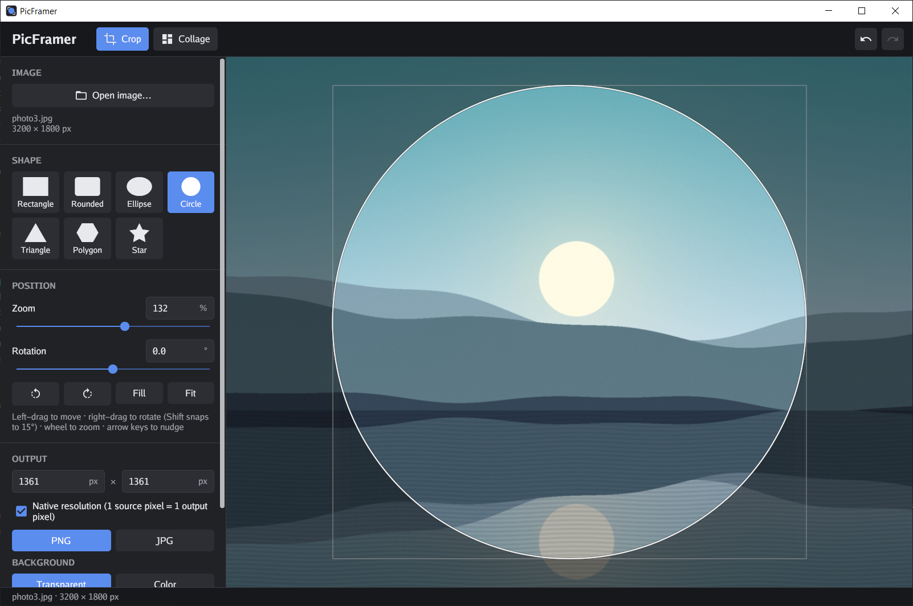
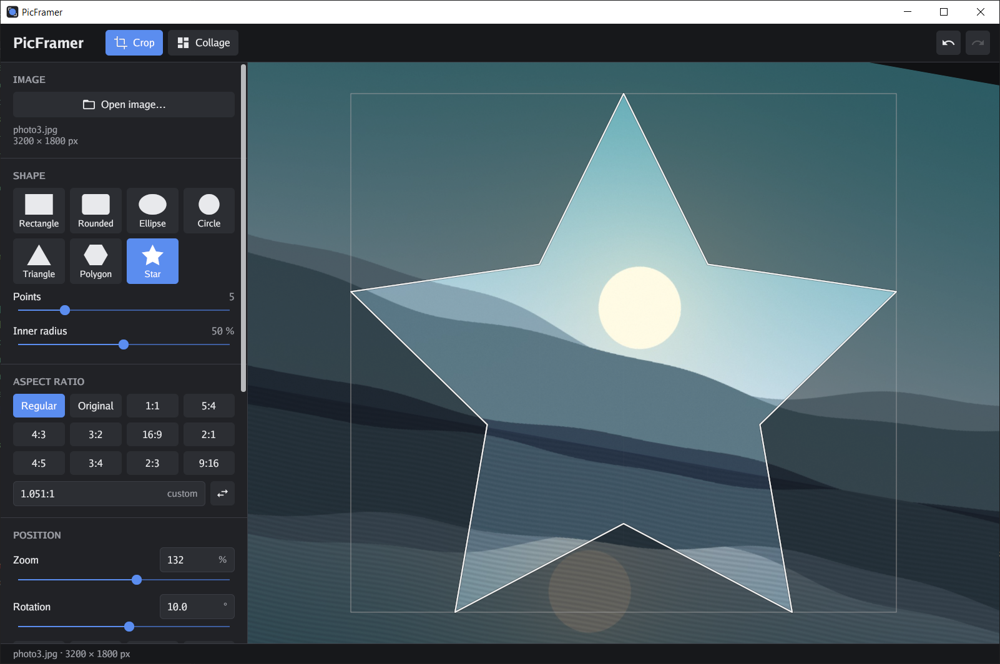
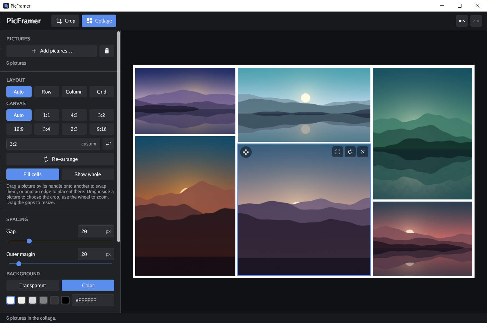
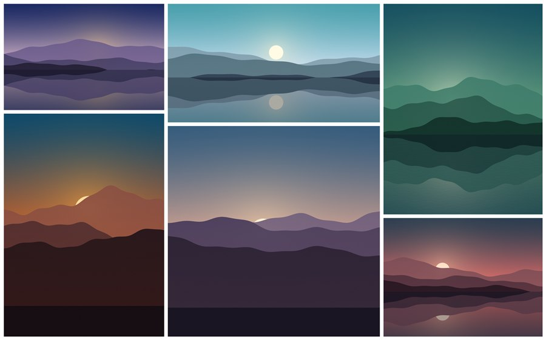

# PicFramer

**Crop pictures into shapes and arrange them into clean collages – a small, fast Windows tool written in Go.**



## Features

**Crop mode**

- Shapes: rectangle, rounded rectangle, ellipse, circle, triangle, regular polygon and star
- Any aspect ratio: presets (1:1, 5:4, 4:3, 3:2, 16:9, …), the picture's original ratio, or your own (`5:4`, `16/9`, `2.35`)
- Move (left mouse button), rotate (right mouse button) and zoom (mouse wheel) the picture underneath the shape until the right part is inside
- Exact zoom and rotation values can be typed in
- Export as PNG (transparent outside the shape) or JPG with a background color
- Output size in pixels, or native resolution (one source pixel per output pixel)

**Collage mode**

- Pictures are placed side by side and on top of each other, no frames or effects
- Arrangement: automatic, one row, one column, or a grid with a chosen number of pictures per row – every picture fits its cell
- Drag pictures to swap them or to place them next to another one; pictures never overlap
- Drag the gaps to resize; move, zoom and rotate each picture inside its cell, or show it whole
- Adjustable gap, outer margin and background color; fixed canvas ratio or automatic
- Output size by long edge, or original size: the collage grows so that no picture is scaled down

**General**

- Preview and export use the same geometry, so the result looks exactly like the preview
- Undo/redo, keyboard shortcuts, EXIF orientation is respected
- Opens JPG, PNG, WebP, GIF, BMP and TIFF
- A single portable `.exe`, no installer, no runtime

| Crop into a star                             | Collage                                       |
| -------------------------------------------- | --------------------------------------------- |
|  |  |

Example results:

<p>
  
  
</p>

## Download

Get `picframer.exe` from the [Releases](https://github.com/mjaepel/picframer/releases) page and run it. Windows 10 or later is required.

You can also drop pictures onto the `.exe` (or use _Open with_): one picture opens in crop mode, several start a collage.

## Usage

The short version:

| Action           | Crop mode                     | Collage mode                                       |
| ---------------- | ----------------------------- | -------------------------------------------------- |
| Move picture     | left-drag                     | drag inside a picture                              |
| Zoom             | mouse wheel                   | mouse wheel over a picture                         |
| Rotate           | right-drag, Ctrl + wheel, `R` | right-drag (fill cells), right-click: 90° (show whole), rotate button |
| Swap / rearrange | –                             | drag the ✥ handle onto another picture or its edge |
| Resize cells     | –                             | drag the gap between pictures                      |

| Shortcut            |                     |
| ------------------- | ------------------- |
| `Ctrl+O`            | open picture(s)     |
| `Ctrl+E`            | export              |
| `Ctrl+Z` / `Ctrl+Y` | undo / redo         |
| `Ctrl+1` / `Ctrl+2` | crop / collage mode |

## Building from source

Requirements: [Go](https://go.dev/dl/) 1.27.2 or newer. No C compiler is needed.

```powershell
git clone https://github.com/mjaepel/picframer.git
cd picframer
.\build.ps1              # vet, test and build dist\picframer.exe
.\build.ps1 -SkipChecks  # build only
```

The release workflow uses the same script. Icon, manifest and version info are generated from `winres/winres.json` and `assets/appicon.png` by [go-winres](https://github.com/tc-hib/go-winres) during the build.

### Project layout

| Path               | Contents                                                                   |
| ------------------ | -------------------------------------------------------------------------- |
| `internal/shape`   | shape outlines and aspect ratio parsing                                    |
| `internal/crop`    | the view transform (zoom, rotation, position) shared by preview and export |
| `internal/collage` | collage layout tree, automatic layout and editing operations               |
| `internal/render`  | full-resolution export rendering                                           |
| `internal/imgio`   | loading (incl. EXIF orientation) and saving                                |
| `internal/ui`      | the user interface, built with [Gio](https://gioui.org)                    |

## License

[MIT](LICENSE)

The sample pictures in the screenshots are generated by a program and free of any rights.
